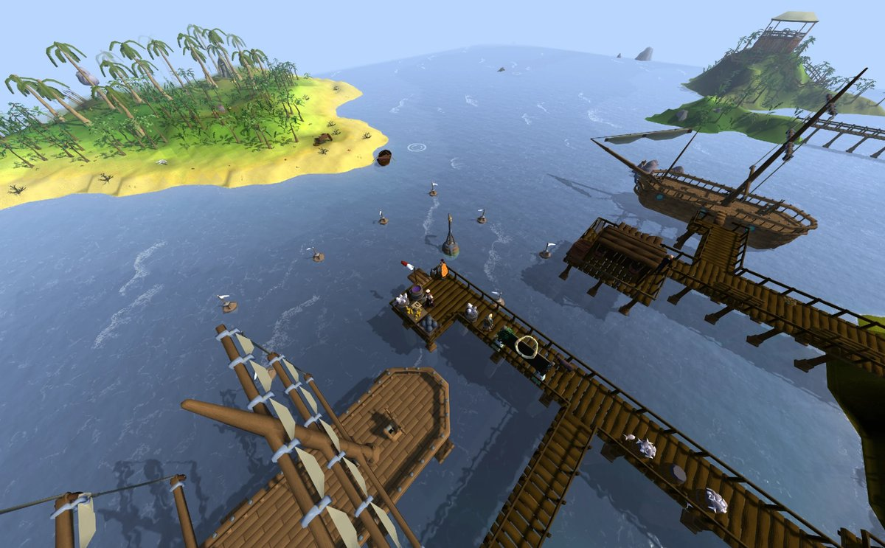
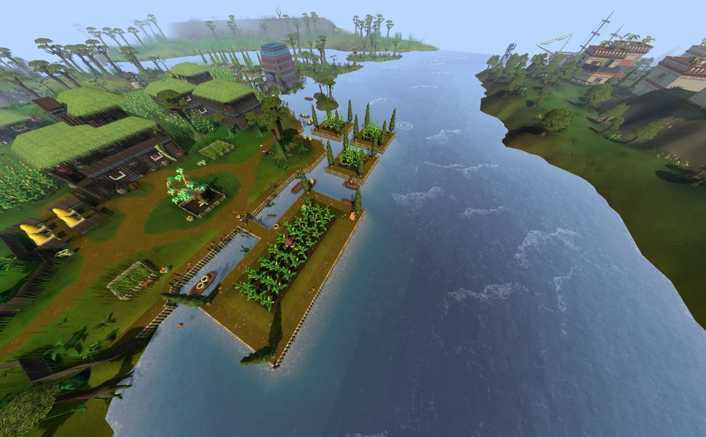
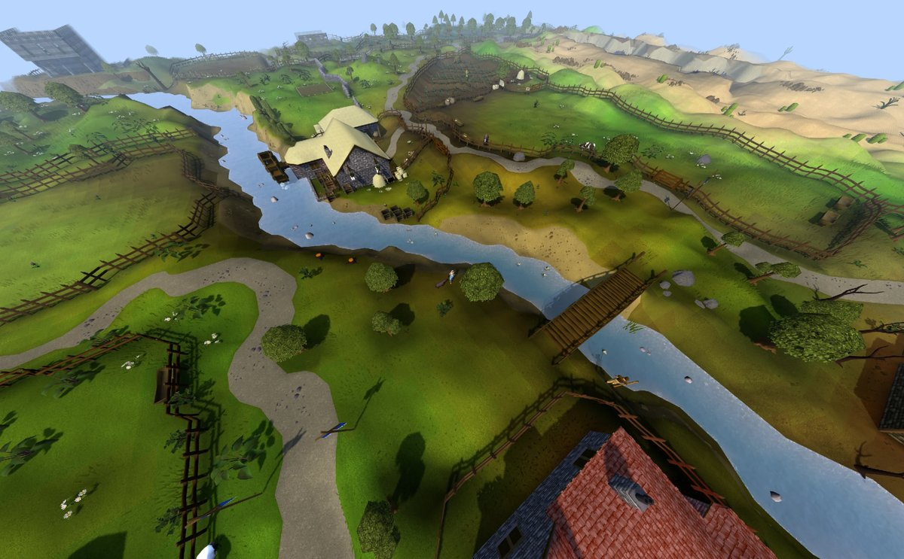
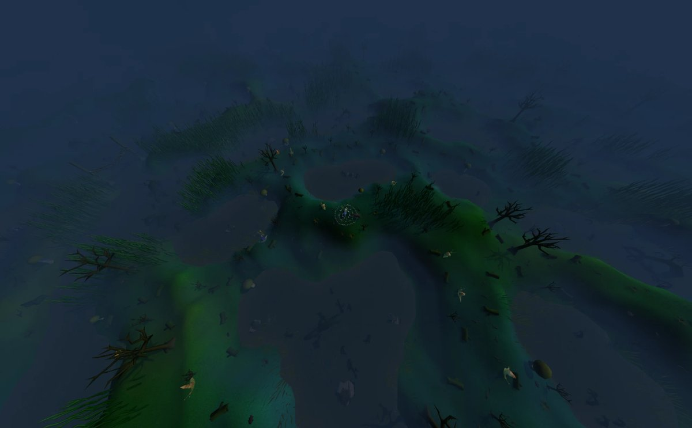
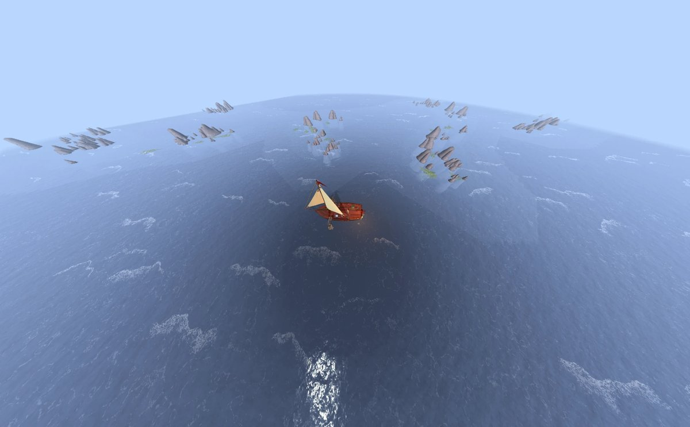
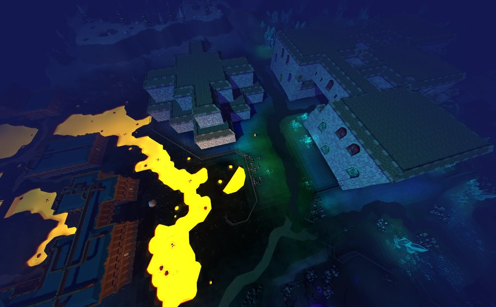

# Water foam cost in game

What the foam costs now, with the shaders at `b87d3734b` (shore-foam).

## Method

- RTX 3080, zone renderer, 150% render scale, camera still.
- About 20 s after each settings change, one Ctrl+Shift+F4 (two 20 s snapshots, 3 s apart).
- Test boats: settings in order, then in reverse, averaging each setting's two runs.
- Cost: the time minus no foam at the same spot. % of scene pass: the cost over that setting's own time.
- No foam means all four foam settings off, which isn't free: with "Shore foam" off, the old fade along shore tile
  edges runs instead, reading the foam texture for every water pixel. So each cost is against that, as a player
  turning the settings off would get.
- At 100%: the cost divided by 2.25, since 150% has 2.25 times the pixels. Probably slightly low, since a little of
  the cost doesn't scale with pixels.

### Fast frames only

Every snapshot's frames fall into two groups about 0.5 ms apart, at every setting, foam or not: at Port Khazard with
no foam, 2.43 and 2.98 ms. The slow frames come in bursts of 1 to 6 frames spread evenly through each second, with
nothing else different: the same objects drawn and the same CPU times. They're most likely other GPU work (the
desktop or other programs) landing during the scene pass. Their share varies from 0 to 50% between snapshots, and
more of them with longer scene passes, which they'd be more likely to overlap.

A plain median follows whichever group has more frames, so it jumped by 0.5 ms now and then. Instead each snapshot's
time is the median of its fast frames, those within 0.25 ms of its 1st percentile (`fast.py` in the session
scratchpad). It used the 10th until one open-sea snapshot had only 7.6% fast frames; of 112 snapshots, that was the
only one the change moved by more than 0.003 ms. With that, every snapshot of a setting agrees within about 0.05 ms, and no pair needed dropping.

## Results

Recorded: 2026-11-17, from 21:52. Each time is the average of every snapshot of that setting at that spot.

### Port Khazard

The same view throughout. The docked ships never move and aren't boats that get wakes.

| Setting | Boats | Scene pass | Cost | % of scene pass | At 100% |
|---|---|---|---|---|---|
| No foam | none | 2.436 ms | — | — | — |
| Everything except boat wakes | none | 2.903 ms | 0.467 ms | 16% | about 0.21 ms |
| Everything | none | 3.007 ms | 0.571 ms | 19% | about 0.25 ms |
| No foam | 16 test boats | 2.436 ms | — | — | — |
| Boat wakes only | 16 test boats | 2.748 ms | 0.312 ms | 11% | about 0.14 ms |
| Everything except boat wakes | 16 test boats | 2.912 ms | 0.476 ms | 16% | about 0.21 ms |
| Everything | 16 test boats | 3.273 ms | 0.837 ms | 26% | about 0.37 ms |

Boat wakes on top of the other foam: 0.104 ms with no boats, 0.361 ms with the test boats.

### Kastori

The test boats don't all fit on the water here, as with real boats. Their pattern repeats every 8 s as they move
between water and land.

| Setting | Boats | Scene pass | Cost | % of scene pass | At 100% |
|---|---|---|---|---|---|
| No foam | none | 3.297 ms | — | — | — |
| Everything except boat wakes | none | 3.749 ms | 0.452 ms | 12% | about 0.20 ms |
| Everything | none | 3.839 ms | 0.542 ms | 14% | about 0.24 ms |
| No foam | 16 test boats | 3.295 ms | — | — | — |
| Boat wakes only | 16 test boats | 3.646 ms | 0.351 ms | 10% | about 0.16 ms |
| Everything except boat wakes | 16 test boats | 3.740 ms | 0.445 ms | 12% | about 0.20 ms |
| Everything | 16 test boats | 4.145 ms | 0.850 ms | 21% | about 0.38 ms |

Boat wakes on top of the other foam: 0.090 ms with no boats, 0.405 ms with the test boats.

### Lumbridge, river

A river too narrow for lace or waves except in a few small spots, with about 215 wandering NPCs drawn (steady
throughout). No boats. Shaders at `9858f82a4`, with the river skips. In order: no foam, shore foam, everything except
boat wakes, everything, no foam again. The two no-foam pairs (2.300, 2.299, then 2.309, 2.307 ms) drifted 0.009 ms;
their average is the base.

| Setting | Boats | Scene pass | Cost | % of scene pass | At 100% |
|---|---|---|---|---|---|
| No foam | none | 2.304 ms | — | — | — |
| Shore foam only | none | 2.322 ms | 0.018 ms | 1% | about 0.01 ms |
| Everything except boat wakes | none | 2.346 ms | 0.042 ms | 2% | about 0.02 ms |
| Everything | none | 2.362 ms | 0.058 ms | 2% | about 0.03 ms |

Lace and waves add 0.024 ms, boat wakes 0.016 ms with no boats, against about 0.1 ms at the harbours, in line with
less water on screen.

### Morytania swamp, small ponds

A worst case for shore foam: many small ponds, so lots of shoreline. About 305 objects drawn, steady throughout. Shaders
at `9858f82a4`. Same order as Lumbridge. The two no-foam pairs (2.947, 2.944, then 2.949, 2.947 ms) agree.

| Setting | Boats | Scene pass | Cost | % of scene pass | At 100% |
|---|---|---|---|---|---|
| No foam | none | 2.947 ms | — | — | — |
| Shore foam only | none | 3.022 ms | 0.075 ms | 2% | about 0.03 ms |
| Everything except boat wakes | none | 3.116 ms | 0.169 ms | 5% | about 0.08 ms |
| Everything | none | 3.173 ms | 0.226 ms | 7% | about 0.10 ms |

Lace and waves add 0.094 ms, more than the shore foam, though waves can't form in ponds this small. Most of it is the
lace, at about 0.7 to 6% opacity in ponds with 2 to 3 tiles of room, above the skip's 1/255. It shows in game as
small patches in most ponds, so it's paying for something visible. Boat wakes add 0.057 ms with no boats. The everything pair is 0.020 ms apart (3.163, 3.183 ms), wider than usual.

### Open sea

Open water to the horizon, a few rock islets far off, and the player's boat stopped in view. 35 objects drawn
throughout. Shaders at `9858f82a4`. The two no-foam pairs (2.609, 2.598, then 2.609, 2.602 ms) agree, so no drift,
despite a seven-minute gap after shore foam.

| Setting | Boats | Scene pass | Cost | % of scene pass | At 100% |
|---|---|---|---|---|---|
| No foam | none | 2.605 ms | — | — | — |
| Shore foam only | none | 2.571 ms | −0.034 ms | −1% | about −0.02 ms |
| Shore foam + lace | none | 2.811 ms | 0.206 ms | 7% | about 0.09 ms |
| Shore foam + lace + waves | none | 3.453 ms | 0.848 ms | 25% | about 0.38 ms |
| Everything | none | 3.634 ms | 1.029 ms | 28% | about 0.46 ms |
| Everything | 16 test boats | 3.898 ms | 1.293 ms | 33% | about 0.57 ms |

- Shore foam is cheaper than none here: with no shore in view it does nothing, while the old fade it replaces reads
  the foam texture for every water pixel.
- Lace adds 0.240 ms, waves 0.642 ms, boat wakes 0.181 ms with no moving boat, and the 16 test boats 0.264 ms more.
- The waves cost about twice what offline timings suggest (0.16 ms for a 1080p screen of open water, about 0.35 ms at
  150%). Not roughness: this is the overworld environment, roughness exactly 1. It's face size; see "Why the open sea
  waves cost so much" below.

### Arceuus, no water

No water on screen; the lava isn't one of 117 HD's water types. Checks that the foam costs nothing where there's no
water. The two settings alternated, twice each, then everything once more, with "Test boat wakes" off.

| Setting | Snapshots | Scene pass |
|---|---|---|
| No foam | 5.040, 5.037, 5.036, 5.036 ms | 5.037 ms |
| Everything | 5.047, 5.047, 5.052, 5.051, 5.053, 5.054 ms | 5.051 ms |

Everything on costs 0.014 ms (0.3% of the scene pass, about 0.006 ms at 100%). Small, but every snapshot with the
foam on is slower than every one without, across all rounds, so it's probably real. With no water pixels, the likely
cause is the bigger shader itself: one program draws everything, and its size can slow all of it a little.

## Why boat wakes cost about 0.1 ms with no boats

Not a nearby boat: WaterBench shows it with no boats at all. Offline, 1080p, all foam, wakes off against on with no
boats (fastest of 100 rounds, game running, so only the differences count):

| Shaders | Wakes on, no boats, extra |
|---|---|
| `028a14e68` (before the wave list) | 0.007 ms |
| `20aa49d6e` (wave list) | 0.020 ms |
| `19e464225` (noise texture), and now | 0.045 ms |

At 150% that's about 0.10 ms over a screen of water, in line with the 0.104 ms (Port Khazard) and 0.090 ms
(Kastori) in game.

Most of it, about 0.03 ms, is the waves' check against `swept` in `oceanWaveCells` (waves a boat crossed stay broken).
With wakes off `swept` is a constant and the check compiles away. The check itself is a few instructions; the cost
comes from how the driver compiles the wave loop once it's there, which its intermediate assembly doesn't show (it
differs only in register names). The rest, about 0.01 ms, is the wake bounds loop.

Tried, all with identical output, none faster:
- Skipping the check when nothing was swept, inside the loop or by calling the waves twice.
- Running the waves before the lace, so `swept` is kept through less.
- Dropping the check's early `continue`, or applying it only at the end.

A second copy of the water code used when no wake is active saved 0.014 of the 0.045 ms, but doubles the water
code and broke 6 of the 16 shader variants as written. Not worth it.

What would remove it all: a second water program without wakes, picked from Java when no wake is active (more compile
time and memory), or a simpler, visibly different sweep that dims wave foam after the loop instead of per wave.

## Why lace and waves cost time on a river

Offline, with WaterBench's faces set up like the middle of a river (`BENCH_FACE`, each vertex's raw shore data),
1080p, all foam with wakes on and no boats unless stated. Breakdown with the game running; fixes timed with it
closed, 5th percentile of 80 to 100 rounds.

Lace needs only 1 tile of room (`OCEAN_LACE_MIN_ROOM`), waves 5. So in a river the lace is worked out across the
middle, where its strength (`OCEAN_LACE_STRENGTH * roughness * laceRoom`) is tiny: at most 0.05% opacity with 1.5
tiles of room, 2.6% with 2.5. The waves never draw, but still cost:

| Part, 2.5 tiles of room | Cost |
|---|---|
| Lace, really running | 0.078 ms |
| Waves: their code being in the shader at all | about 0.012 ms |
| Waves: per-pixel setup that finds no room | about 0.008 ms |
| Waves: the vertex shader's wave list | about 0.004 ms |

### Fixes tried (shader variants only, nothing changed in the repo)

1. **Lace skip:** skip lace under 1/255 opacity, where it can't change a pixel's color.
2. **Speck read skip:** skip the ocean speck texture read where nothing uses it (no lace, no room for waves, no wake),
   reading it with explicit derivatives since that's now decided per pixel.
3. **Wave list skip:** skip the vertex shader's wave list on faces where no vertex has room for waves (all under
   `SHORE_WAVE_MIN_ROOM`). Exact. Needs that setting shared with the vertex shader.

| Setup | Now | All three | Lace and wave list skips only |
|---|---|---|---|
| River, 1.5 tiles of room | 0.272 ms | 0.214 ms (−21%) | 0.222 ms (−18%) |
| River, 2.5 tiles of room | 0.285 ms | 0.277 ms (−3%) | |
| River, 3.5 tiles of room | 0.292 ms | 0.291 ms | |
| Harbour shore | 0.369 ms | 0.359 ms (−3%) | 0.365 ms (−1%) |
| Open sea | 0.352 ms | 0.354 ms (+0.6%) | 0.353 ms |
| Open sea, 16 boats | 0.517 ms | 0.517 ms | |
| Lace only, open sea | 0.185 ms | 0.186 ms | |
| Open sea, repeating regions | 0.351 ms | 0.354 ms | |

Largest pixel change 0.0035, under 1/255, in every setup, spread as fine speckle through the lace with no pattern
change: from the lace skip near its threshold, and from explicit derivatives rounding slightly differently.

The waves' code-presence cost has no cheap fix, as with the boat wakes.

### Applied in `9858f82a4`: the lace and wave list skips

The speck read skip was left out, since it cost about 0.002 ms on open sea. `SHORE_WAVE_MIN_ROOM` moved to
`ocean_wave_cells.glsl`, and `oceanWaveFaceHasRoom` there decides the wave list skip. Against `b87d3734b`, game closed,
5th percentile of 60 to 100 rounds:

| Setup | Before | After | Largest pixel change |
|---|---|---|---|
| River, 1.5 tiles of room | 0.263 ms | 0.213 ms (−19%) | 0.0006 |
| River, 2.5 tiles of room | 0.281 ms | 0.270 ms (−4%) | 0.0028 |
| Harbour shore | 0.369 ms | 0.360 ms (−2%) | 0.0027 |
| Open sea | 0.340 ms | 0.340 ms | none |
| Open sea, 16 boats | 0.506 ms | 0.505 ms | none |
| Open sea, repeating regions | 0.377 ms | 0.378 ms | none |
| Daylight cycle, 16 boats | 0.852 ms | 0.848 ms | none |

All 16 shader variants compile and link.

In game at Lumbridge (the same view as the Lumbridge results above), everything on, 150%, swapping the shaders in place between
recordings (new, old, new; each step of the swap checked to compile first):

| Shaders | Snapshots | Scene pass |
|---|---|---|
| New | 2.356, 2.354 ms | 2.355 ms |
| Old | 2.379, 2.374 ms | 2.377 ms |
| New again | 2.366, 2.362 ms | 2.364 ms |

The two new recordings drifted 0.009 ms apart, so against their average the saving is 0.017 ms (0.013 to 0.022 ms
against either one), about 0.7% of the scene pass, or about 0.008 ms at 100%.

## Why the open sea waves cost so much

An earlier version of these notes put it down to roughness 2. That was wrong: the open sea view was under the
overworld environment, where roughness is exactly 1 (wind strength only shifts it by about a tenth elsewhere).

The cause is face size. WaterBench draws water flat, 48 tiles across, so faces are about 40 px wide; looking out to
the horizon, most faces are a few pixels wide. With `BENCH_SPAN` (tiles across the screen), 1080p, best of 40 to 60
rounds:

| Tiles across | Face size | Waves cost | Boat wakes, no boats |
|---|---|---|---|
| 48 | 40 px | 0.137 ms | 0.042 ms |
| 96 | 20 px | 0.150 ms | 0.056 ms |
| 192 | 10 px | 0.179 ms | 0.061 ms |
| 480 | 4 px | 0.375 ms | 0.047 ms |
| 960 | 2 px | 1.29 ms | 0.146 ms |

The cost is in the pixels: the GPU shades 2x2 blocks, and with faces a couple of pixels wide most blocks straddle
several faces, so the wave code runs several times per pixel. Not the vertex shader's wave list: forcing every cell
listed (no list work) was slower at every size, 1.849 against 1.795 ms at 2 px, though the list's saving shrinks from
0.218 ms at 40 px to 0.054 ms at 2 px. This is why far wave thinning pays off.

## Far wave thinning, density and spacing (in `41b64f252`)

Tested as two switches in the experimental settings, each a shader define. Thinning is now always on, and the detail
fade was dropped:

- **Test far wave thinning** (`OCEAN_WAVE_FAR_THINNING`): a wave's spawn chance falls from 1 to `OCEAN_WAVE_FAR_KEEP`
  (0.5) between `OCEAN_WAVE_FAR_START` and `OCEAN_WAVE_FAR_END` (24 and 64 tiles) from the camera. The distance is
  from where the camera was in the second the wave spawned, recorded in Java (`WaterSurfaceManager`,
  `waveCameraHistory` at the end of the global uniforms), so moving the camera never changes a wave already going. Off
  where waves repeat in every region.
- **Test far wave detail** (`OCEAN_WAVE_FAR_DETAIL`): the two finest of the wave edges' four noise layers fade out
  over the same distances.

Offline, 1080p, all foam, no boats, with every wave far from the camera (the most either can save):

| | Roughness 1 | Roughness 2 |
|---|---|---|
| Waves cost | 0.148 ms | 0.253 ms |
| With far thinning | 0.005 ms less | 0.092 ms less (36%) |
| With far detail | no change | no change |

The game ran at roughness 1, where this flat benchmark, with its big faces, shows almost no saving. In game the
far faces are tiny and their pixels expensive, so thinning saved far more there (below).

### In game: far wave thinning at the open sea

The open sea view again (everything on read 3.634 ms in the first run, and 3.634 ms again now), 150%, toggling only
the thinning switch.

| Thinning | Snapshots | Average |
|---|---|---|
| Off | 3.635, 3.633 ms | |
| On | 3.625, 3.591, 3.559, 3.569 ms | 3.586 ms |
| Off again | 3.668, 3.645 ms | |
| Off, both pairs | | 3.645 ms |

Saves about 0.06 ms at 150% (0.05 to 0.08 depending on which snapshots), about 0.03 ms at 100%: around a tenth of
the waves' 0.642 ms. The snapshots vary more than usual with the waves on, as the number of waves on screen keeps
changing. Turning thinning on judges every wave at once, since the camera history starts full.

### In game: how many far waves to keep

`OCEAN_WAVE_FAR_KEEP` varied live at the same open sea view, everything on, 150%. Thinning off, six snapshots
across the session: 3.635, 3.633, 3.668, 3.645, 3.665, 3.596 ms, average 3.640 ms. One 0.45 pair was dropped for a
passing NPC boat's wake.

| Keep | Snapshots | Average | Saving at 150% | Saving at 100% | Looks |
|---|---|---|---|---|---|
| 0.01 | 3.432, 3.461 ms | 3.447 ms | 0.193 ms (5%) | about 0.09 ms | no far waves at all |
| 0.25 | 3.549, 3.559 ms | 3.554 ms | 0.086 ms (2%) | about 0.04 ms | sparser far away, doesn't look bad |
| 0.3 | 3.542, 3.516 ms | 3.529 ms | 0.111 ms (3%) | about 0.05 ms | |
| 0.35 | 3.537, 3.560 ms | 3.549 ms | 0.091 ms (2%) | about 0.04 ms | |
| 0.4 | 3.591, 3.570 ms | 3.581 ms | 0.059 ms (2%) | about 0.03 ms | |
| 0.45 | 3.612, 3.670 ms | 3.641 ms | none | none | |
| 0.5 | 3.625, 3.591, 3.559, 3.569 ms | 3.586 ms | 0.054 ms (1%) | about 0.02 ms | no visible change |

Percentages are of the scene pass. Snapshots of one setting differ by up to about 0.07 ms here, as the waves on screen
keep changing, so neighbouring steps overlap. Broadly: 0.25 to 0.35 save about 0.1 ms, 0.4 to 0.5 about half that.

### In game: far wave detail

Same view, everything on, thinning off, toggling only the detail switch (on, off, on).

| Detail fade | Snapshots | Average |
|---|---|---|
| On | 3.725, 3.652, 3.608, 3.680 ms | 3.666 ms |
| Off | 3.644, 3.661 ms | 3.653 ms |

No saving: on is 0.013 ms slower, well inside the noise (snapshots of one setting span up to 0.12 ms here). Matches
offline, where it changed nothing. The noise layers it drops are cheap texture reads.

### In game: lower wave density

`OCEAN_WAVE_AMOUNT` 0.45 against 0.55, swapped live at the same open sea view, everything on, thinning off, 150%.
Uncommitted.

| Density | Snapshots | Average |
|---|---|---|
| 0.45 | 3.569, 3.539 ms | |
| 0.55 | 3.664, 3.662 ms | 3.663 ms |
| 0.45 again | 3.600, 3.609 ms | |
| 0.45, both pairs | | 3.579 ms |

Saves about 0.08 ms at 150% against the 0.55 pair recorded between them (0.06 ms against the session's earlier
thinning-off average of 3.640 ms): about 2% of the scene pass, about 0.03 to 0.04 ms at 100%. Unlike the thinning, it
thins the waves near the camera too.

### In game: lower density and far thinning together

Density 0.45 throughout, far thinning (keep 0.325) toggled on, off, on, same view.

| Setup | Snapshots | Average |
|---|---|---|
| Density 0.55, thinning off (all 8 snapshots this session) | 3.596 to 3.668 ms | 3.646 ms |
| Density 0.45, thinning off (3 pairs) | 3.569, 3.539, 3.600, 3.609, 3.623, 3.594 ms | 3.589 ms |
| Density 0.45, thinning on (2 pairs) | 3.484, 3.489, 3.592, 3.537 ms | 3.526 ms |

| Change, against density 0.55 and no thinning | Saving at 150% | % of scene pass | At 100% |
|---|---|---|---|
| Density 0.45 | 0.057 ms | 1.6% | about 0.025 ms |
| Density 0.45 and thinning | 0.120 ms | 3.3% | about 0.05 ms |

The two add up: thinning saves 0.063 ms on top of the lower density, close to what it saved alone. Together they take
about a fifth off the waves' 0.642 ms. The second thinning-on pair read 0.08 ms above the first, so these are rough
to about ±0.03 ms.

### Chosen values (in `41b64f252`)

- `OCEAN_WAVE_AMOUNT` 0.45 (was 0.55).
- Far thinning, still a test switch: keep 0.325, from 32 to 80 tiles (moved out from 24 to 64 after the
  measurements above, so it's less noticeable). Not measured at the new distances; it thins less of the view, so it
  likely saves somewhat less than the 0.063 ms measured at 24 to 64 tiles.
- Wave centres in the middle 20% of their cell (was the middle half), so neighbours overlap less but still sometimes
  catch up, as real waves do. Tried down to 2%: no grid showed even then. The spacing costs the same: at the open sea
  with density 0.45 and thinning on, 2% read 3.567, 3.499 ms (3.533) against the old 3.547, 3.504 ms (3.526), inside
  the noise.

